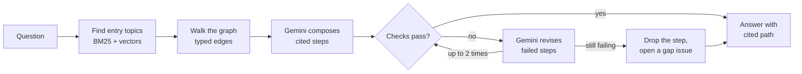

# KnowledgeFlow

**Answer questions across documentation silos, from the links writers already
maintain.**

Product teams write documentation in separate documentation sets. Each set
links well inside itself, but questions often cross sets, and nothing joins
them. KnowledgeFlow is an agent that answers an employee's question with a
cited path across documentation sets. It builds a knowledge graph from the
structure that writers already maintain in DITA and docs as code: maps,
relationship tables, keys, content references, links, and subject
classifications. Every step of every answer is checked against its source
before anyone sees it.

**[Read the design document](https://raosiddharthp.github.io/KnowledgeFlow/)**

## Status

Design document, version 0.1 (October 2026). This repository contains the
design for a minimum viable product (MVP). The agent isn't built yet. The
simulator in the design document is a scripted demo and doesn't call a model.

## The problem

Here's one real question that crosses two Google Cloud documentation sets:

> My TPU VM has no external IP address. How does it reach a package index on
> the internet?

| Step | Where the answer is | Join from the step before |
| ---- | ------------------- | ------------------------- |
| 1. Create a TPU VM without an external IP address | Cloud TPU docs: [Configure networking and access](https://docs.cloud.google.com/tpu/docs/configure-networking-access-compute) | Start |
| 2. Reach Google APIs, such as Cloud Storage | Same page: Private Google Access | Linked |
| 3. Reach a destination on the internet | Cloud NAT docs: [Cloud NAT overview](https://docs.cloud.google.com/nat/docs/overview) | **No link** |

Both versions of the TPU networking page explain how to keep a TPU VM on
internal IP addresses and how to reach Google APIs. Neither mentions Cloud
NAT. The answer exists, but you have to already know the networking product
to find it.

This isn't rare. In the
[2024 Stack Overflow Developer Survey](https://survey.stackoverflow.co/2024/professional-developers),
61% of professional developers spent more than 30 minutes a day searching for
answers, and 30% said knowledge silos affected their productivity ten or more
times a week.

### Why a language model graph isn't the answer

GraphRAG builds a knowledge graph by asking a language model to extract it
from every document. Microsoft notes that it suits a use case only when its
benefits outweigh the upfront cost of building the graph index
([Pure AI](https://pureai.com/Articles/2024/07/12/Microsoft-Open-Sources-AI-Tool.aspx)).
Newer variants such as
[LazyGraphRAG](https://www.microsoft.com/en-us/research/blog/lazygraphrag-setting-a-new-standard-for-quality-and-cost/)
lower that cost, but every edge is still a model guess.

DITA content already holds most of the edges. Writers author them, review
them, and keep them current. KnowledgeFlow reads them first and asks the
model only about what the structure doesn't cover.

## What it does

KnowledgeFlow has two parts.

-   **The build** runs on every docs merge. It reads the structure of each
    documentation set and writes the graph. Gemini reads prose only to find
    subjects that a topic names but doesn't link.
-   **The answer** runs on every question. It finds entry topics, walks the
    graph, and writes an answer in which every step cites a topic and the
    edge that reached it.



### The graph

| Edge | Read from | Status |
| ---- | --------- | ------ |
| `contains` | DITA map hierarchy or MyST table of contents | Authored |
| `related` | DITA relationship table row | Authored |
| `reuses` | Conref or MyST include | Authored |
| `states` | Key reference or MyST substitution | Authored |
| `links-to` | Cross-reference or MyST link | Authored |
| `about` | DITA subject reference | Authored |
| `mentions` | Gemini, from prose with no link | Proposed |

A shared subject scheme is what joins the sets. Each team classifies its own
topics against the same subjects, once. No one has to maintain a link from
every TPU topic to every networking topic.

### Design principles

-   **Structure first, model second.** Six of seven edge types come from
    lines that writers wrote. Every authored edge records the file and line it
    came from.
-   **The model answers. The checks decide.** Every step must cite a topic in
    the graph path, and every number, flag, field, and command must appear in
    its source. Plain Python checks decide pass or fail. The agent can't
    override them.
-   **No unchecked step reaches the reader.** A step that still fails after two
    revisions is dropped, the answer says so, and writers get a gap issue with
    the missing edge.
-   **Writers own the content model.** A model-found edge is labeled in every
    answer that uses it, and it reaches the information architect as a pull
    request. Approved edges become relationship table rows, so the next build
    reads them without the model.
-   **The model is called less over time.** As proposals become structure,
    fewer edges need a model call.

## Technology

The MVP runs on Google Cloud and free or open-source tools.

| Part | Technology | Free tier or license |
| ---- | ---------- | -------------------- |
| Agent framework | [Agent Development Kit](https://github.com/google/adk-docs) | Apache 2.0 |
| Model | Gemini 3.8 Flash (`gemini-3.8-flash`) | [Gemini API free tier](https://ai.google.dev/gemini-api/docs/pricing) |
| Embeddings | [`gemini-embedding-001`](https://developers.googleblog.com/en/gemini-embedding-available-gemini-api/) | Free tier available |
| Graph build | Python, lxml, MyST-Parser, [NetworkX](https://networkx.org/documentation/networkx-2.5/license.html) | Open source; NetworkX is 3-clause BSD |
| Graph and vector store | [Firestore](https://cloud.google.com/firestore/docs/vector-search) | [50,000 reads and 20,000 writes a day](https://cloud.google.com/firestore/pricing) |
| Exact-term search | [SQLite FTS5](https://www.sqlite.org/fts5.html#the_bm25_function) with BM25 | Public domain |
| Build trigger | GitHub Actions | [Free for public repositories](https://docs.github.com/en/billing/concepts/product-billing/github-actions) |
| Agent runtime | Cloud Run service | [180,000 vCPU-seconds a month](https://cloud.google.com/run/pricing) |
| Question log | BigQuery | [10 GiB storage and 1 TiB of queries a month](https://cloud.google.com/bigquery/pricing) |
| Ask page | Firebase Hosting | [No-cost plan](https://firebase.google.com/pricing) |

**Data handling.** The sample content is public, so the Gemini API free tier
is acceptable for the MVP. Content sent on the free tier is used to improve
Google products, so private documentation needs the paid tier
([Gemini API pricing](https://ai.google.dev/gemini-api/docs/pricing)).

**Known limits.** The MVP keeps the graph in memory, which suits the sample
sets. A full documentation set needs a graph database. The MVP has no access
control for each documentation set, because the sample content is public.

## View locally

The design document is a single HTML page with no build step.

1.  Clone the repository:

    ```sh
    git clone https://github.com/raosiddharthp/KnowledgeFlow.git
    cd KnowledgeFlow
    ```

1.  Start a local web server:

    ```sh
    python3 -m http.server 8000
    ```

1.  In your browser, go to `http://localhost:8000`.

You can also open `index.html` directly in a browser.

## Repository contents

| File | Description |
| ---- | ----------- |
| `index.html` | The design document, published with GitHub Pages |
| `README.md` | This file |
| `LICENSE` | MIT License |
| `.gitignore` | Files that Git ignores |

## Sample content and attribution

The sample content is adapted from the Google Cloud
[Cloud TPU](https://docs.cloud.google.com/tpu/docs) and
[Cloud NAT](https://docs.cloud.google.com/nat/docs/overview) documentation and
the [Cloud NAT release notes](https://docs.cloud.google.com/nat/docs/release-notes).
Google publishes this content under the
[Creative Commons Attribution 4.0 License](https://creativecommons.org/licenses/by/4.0/),
as described in the
[Google Developers Site Policies](https://developers.google.com/site-policies).
The adapted content is modified from the original. The subject classifications
in the sample sets are added for this design and aren't part of Google's
published pages.

The sample questions, issue numbers, and pull requests are written for this
design and aren't Google records.

This is a portfolio project. Google hasn't engaged, sponsored, or endorsed this
work. Stakeholders in the design document are job roles, not real people, and
the readers are fictional.

## Part of a series

This project is the third in a series of design documents. Each one solves one
economic problem in documentation, and each builds on the same sample content.

1.  [MANIFEST](https://raosiddharthp.github.io/Manifest/): migrate DITA XML to
    docs as code and prove that no content was lost.
1.  [The Autonomous Author](https://raosiddharthp.github.io/The-Autonomous-Author/):
    run the docs loop at the pace of the code loop, with a first draft on every
    merge.
1.  **KnowledgeFlow**: answer questions across documentation silos, from the
    links writers already maintain.

KnowledgeFlow replaces an earlier, enterprise-scale design of the same name
(version 2.1), which was built on Neo4j Aura Enterprise and GKE. This version
gets the same knowledge graph from DITA structure, on free tiers.

## Contact

Siddharth Rao. To ask a question or suggest a change,
[open an issue](https://github.com/raosiddharthp/KnowledgeFlow/issues).

## License

The design document, diagrams, and code in this repository are licensed under
the [MIT License](LICENSE). Adapted Google content remains under the Creative
Commons Attribution 4.0 License.
